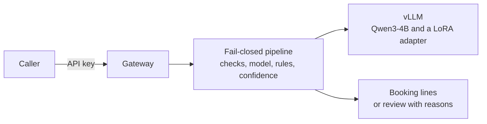

# Open-source LLM Adaptation

[](https://github.com/mgetech/open-llm-adaptation/actions/workflows/ci.yml)

I fine-tune a small open-weight LLM (Qwen3-4B, QLoRA) to turn the text of an invoice or receipt into booking lines, and to flag anything uncertain for review instead of guessing. I evaluate it against a few-shot baseline and serve it with vLLM on GPUs I control.

## What it is for

A bookkeeping or tax firm gets invoices, credit notes and receipts as text. For each one, a person decides which account of the chart (SKR03) every line belongs to and which VAT rate applies (19, 7 or 0). This project suggests those booking lines. When it is not sure, because a document is unusual, the numbers do not add up or the model's confidence is low, it sends the document to a person with the reason instead of guessing. It never books a flagged document by itself. For example, an invoice for connector kits and cables with reverse charge comes back as two items booked to one account, with the total, the date and a confidence.

The documents of a firm are confidential, so the model is an open-weight one that runs on GPUs the firm controls, not a hosted API.

## How it works

- **The model copies and classifies, code calculates.** It reads the text, copies the supplier, date, total and items, and picks an account and a VAT rate for each. Code does the arithmetic and the checks.
- **The pipeline fails closed.** Checks before the model, checks on its answer and a confidence threshold decide whether a document is booked or goes to review. Any error goes to review.
- **vLLM serves it behind a gateway** with API keys and an audit log that never holds the document text.
- **A gate fixed before training judges it**, with 10 checks, instead of a look at a few examples.

**About the data:** I use no real client data. The training and test data is generated by code from a seed, and the supplier names are made up. The booking rules and the chart of accounts are an illustrative subset of SKR03, not tax advice.

## Result

The shipped configuration is Qwen3-4B fine-tuned for one epoch on the round 3 data, with the pipeline rules and a confidence threshold of 0.9817.

- **On dev and `dev_real` it passes every gate check those two sets can show.** Automation is 0.76 and 0.65, accuracy on automated documents 0.995 and 0.960, and the critical-error rate 0.0049 and 0.000 (limit 0.005). I chose the threshold on these two sets, so this is validation, not a test.
- **On held-out data it did not pass the gate.** In the round 3 run it passed 7 of 10 checks. It beat few-shot (p < 0.001) and the generalisation gap was 0.027, but accuracy on automated documents (0.938 against 0.95 with `gold`, 0.933 with `gold_v2`), the critical-error rate (0.043 with `gold`, 0.051 with `gold_v2`, against 0.005) and prompt-injection success failed. I found the causes afterwards and fixed them. I have not yet run a fresh held-out test of the fixed configuration, so I do not claim it passes.
- **On realistic documents it looks strong but is not held out.** Re-scored after the fact, accuracy on automated documents is 1.000 on `gold` and 0.938 on `gold_v2` (one critical error in 16 automated documents). Both sets were seen before, so I label these post-hoc.
- **Training longer did not help.** Two epochs were better on dev and worse on `dev_real`, with confident wrong answers, so I ship one epoch.

`docs/results.md` has the tables, the results of every round and what each one taught me. The table below is written from the saved results by `make report SYSTEM=qwen3-4b-sft-r3-0 BASELINE=qwen3-4b-fewshot-r3 ROUND=3`.

<!-- results:start -->
**Validation, not a test.** `qwen3-4b-sft-r3-0` on dev and `dev_real`, with the confidence threshold 0.9817 chosen on both. I chose the settings on these two sets, so they guide choices and are not a claim.

| check | limit | dev | dev_real |
|---|---|---|---|
| automation rate | >= 0.6 | 0.761 pass | 0.649 pass |
| accuracy on automated documents | >= 0.95 | 0.995 pass | 0.960 pass |
| critical-error rate | <= 0.005 | 0.0049 pass (1 of 205 automated) | 0.0000 pass (0 of 50 automated) |
| review-flag recall | >= 0.95 | 0.969 pass | 1.000 pass |

The held-out result, the post-hoc re-score, the training runs, the run on Azure and the chart are in `docs/results.md`.
<!-- results:end -->

## Architecture



The model copies the amounts and picks accounts; code does the arithmetic and the checks. Anything uncertain, or any failure, goes to review. `docs/architecture.md` has the pipeline step by step, the gateway API and the deployment.

## Quickstart

```
make setup
make test
make stage-gate SYSTEM=qwen3-4b-sft-r3-0 ROUND=3 OUT_DIR=results/round3/rescored
```

The last command prints the validation table from the saved results. It needs no GPU. Training and evaluation run on Kaggle (`notebooks/kaggle_train.ipynb`).

## Limitations

- The data is synthetic. Part of it was rewritten by language models to look more like real documents, but it is not real client data, and `dev_real` and the gold sets are small (44 to 96 documents).
- The model still makes confident mistakes between neighbouring accounts (repairs and maintenance against software licences, training against legal and consulting fees) and between food and non-food VAT on receipts. The pipeline cannot catch them with a confidence threshold.
- The critical-error limit of 0.5% needs about 600 automated test documents to show. My test sets have a few hundred.
- Only one seed was trained for the shipped size.

## Next steps

- A fresh held-out run on newly generated test sets and the sealed `gold_v3`.
- Training data aimed at the account pairs and the food against non-food VAT cases, and DPO on confident mistakes.
- Two-seed agreement.
- The serving benchmark: load and latency on a GPU machine.
- A gold set built from real anonymised documents with a tax expert.

## Documents

- `docs/architecture.md`: the components, the pipeline, the gateway API and the deployment.
- `docs/adr/`: the nine decisions behind them, one short file each.
- `docs/results.md`: the results, the rounds and the post-hoc re-scoring.
- `docs/gpu-sizing.md`: memory, training on one or two GPUs and capacity on a T4.
- `docs/model-card.md`: the card of the adapter, with its files, training and limits.
- `docs/compliance.md`: secrecy, personal data, audit log, isolation and supply chain, and where each control lives.
- `results/README.md`: the layout of `results/` and the commands that write each file.

## Licence

The code is under Apache 2.0. The published adapter weights are under CC BY-NC 4.0, for research and demonstration only (`docs/model-card.md`).
