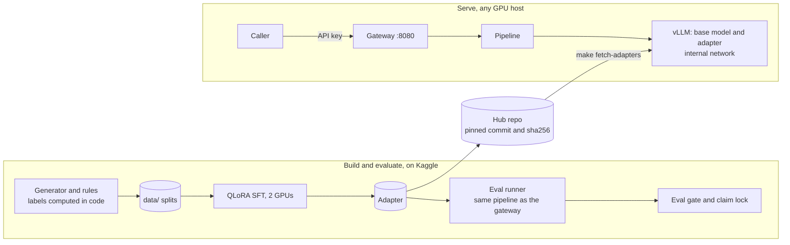
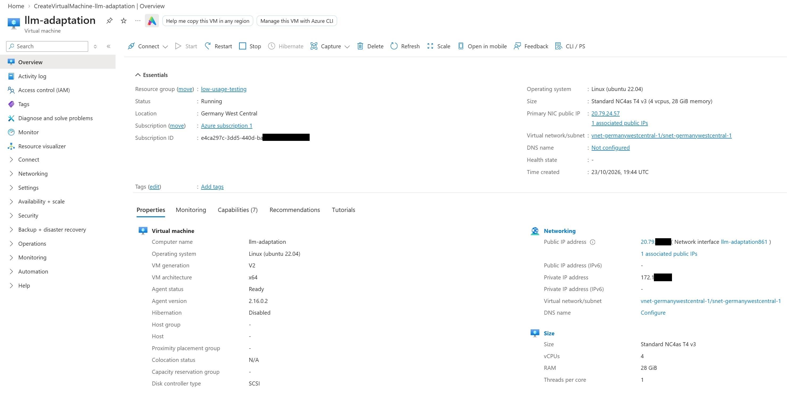
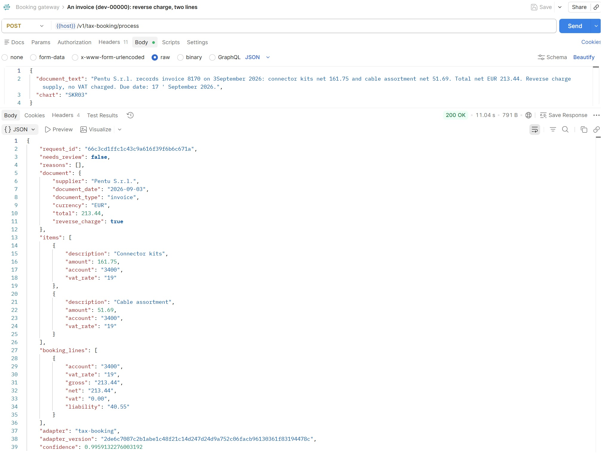

# Open-source LLM Adaptation

[](https://github.com/mgetech/open-llm-adaptation/actions/workflows/ci.yml)

I fine-tune a small open-weight LLM (Qwen3-4B, QLoRA) to turn the text of an invoice or receipt into booking lines, and to send anything uncertain to a person instead of guessing. I judge it with a strict gate of 10 checks, written before training, that includes a significance test against a few-shot baseline. I serve it with vLLM behind an authenticated gateway on GPUs I control, including an Azure VM in Germany.

## Contents

- [Usecase](#usecase)
- [Tech stack](#tech-stack)
- [How I built it](#how-i-built-it)
- [Results](#results)
- [Running it on Azure](#running-it-on-azure)
- [Setup](#setup)
- [Limitations](#limitations) and [Next steps](#next-steps)
- [What I wanted to show](#what-i-wanted-to-show)
- [Documents](#documents)
- [Licence](#licence)

## Usecase

A bookkeeping or tax firm gets invoices, credit notes and receipts as text. For each one, a person decides which account of the chart (SKR03) every line belongs to and which VAT rate applies (19, 7 or 0). This project suggests those booking lines. When it is not sure, because a document is unusual, the numbers do not add up or the model's confidence is low, it sends the document to a person with the reason. It never books a flagged document by itself, so a wrong answer fails towards a person looking, not towards a wrong booking.

The documents of a firm are confidential, so the model is an open-weight one that runs on infrastructure the firm controls, not a hosted API.

### An example

The request (the gateway's `POST /v1/tax-booking/process`):

```json
{
  "document_text": "NORDPAPER GmbH  Invoice 2026-1184  30.09.2026\n2x Printer paper A4 ... 23.80\n1x Tax handbook 2026 ... 21.40\nNet 19%: 20.00  VAT 19%: 3.80\nNet 7%: 20.00  VAT 7%: 1.40\nTotal EUR 45.20",
  "chart": "SKR03"
}
```

What the model returns, as one JSON object that a schema constrains. It copies and classifies; it never calculates:

```json
{
  "supplier": "Nordpaper GmbH",
  "document_date": "2026-09-30",
  "document_type": "invoice",
  "currency": "EUR",
  "total": 45.20,
  "items": [
    {"description": "Printer paper A4", "amount": 23.80, "account": "4930", "vat_rate": "19"},
    {"description": "Tax handbook 2026", "amount": 21.40, "account": "4940", "vat_rate": "7"}
  ],
  "reverse_charge": false,
  "needs_review": false,
  "reason": "Office supplies at 19%, book at 7%"
}
```

Code then checks the answer (the items add up to the total, the VAT matches what the document prints, the accounts exist) and calculates the booking lines: 23.80 gross on 4930 is 20.00 net and 3.80 VAT, 21.40 gross on 4940 is 20.00 net and 1.40 VAT. If any check fails, or the confidence of an account is below the threshold, the response says `needs_review` with the reasons instead.

## Tech stack

| Part | What I used |
|---|---|
| Model | Qwen3-4B (shipped) and Qwen3-1.7B (compared), Apache 2.0 |
| Fine-tuning | QLoRA (4-bit NF4, LoRA rank 16) with PEFT, TRL, Transformers and bitsandbytes, PyTorch 2.13 |
| Serving | vLLM 0.30.0 with LoRA adapters and JSON-schema guided output |
| API | FastAPI and Pydantic behind uvicorn, Prometheus metrics, JSON-lines audit log |
| Deployment | Docker Compose, with vLLM on a network that has no route out |
| Compute | Kaggle (2x T4) to train and evaluate, an Azure `Standard_NC4as_T4_v3` (one T4) to serve |
| Models and adapter | Hugging Face Hub, pinned revisions and a checked hash |
| Code | Python 3.12, uv, ruff, pytest, GitHub Actions, `make` as the only interface |

## How I built it



A document goes through a pipeline of plain code around the model. It is automated only if every step passes, and any failure or exception ends in review with a reason:

1. **Document checks before the model.** Empty or too long text, an unsupported chart, no total, a foreign currency, heavy noise or an instruction hidden in the text send the document to review without a model call.
2. **Pseudonymise.** IBANs, email addresses, phone numbers and tax IDs become placeholders.
3. **The model.** The adapter answers with JSON that a schema constrains, at temperature 0, and the log-probabilities of its tokens are kept.
4. **Checks on the answer, in code.** The items add up to the total, the VAT matches what the document prints, the accounts exist, and asset limits and reverse charge are checked.
5. **Confidence.** The confidence is the lowest probability the model gave to any account it chose. It is not an accuracy: below the threshold of 0.9817 (a setting in `configs/serve.yaml`, chosen on `dev` and `dev_real` so that critical errors stay within their limit) the document goes to review. On `dev` and `dev_real` that threshold still lets 76% and 65% of documents through.

[`docs/architecture.md`](docs/architecture.md) has the step-by-step flow with every review reason.

**Rounds** 

I worked in three rounds. In each round I generated new data, trained both models (4B and 1.7B) and ran the gate, and the failures of one round shaped the generator of the next. To keep the test sets honest, every round used a new seed and new test splits, and the `gold` sets and `dev_real` were never used to change the generator. Round 3 is the one I ship, and it is the one the tables below describe.

**Data** 

I use no real client data. A seeded generator writes invoices, credit notes and receipts in twelve layouts, with noise, edge cases and a canary name for leak checks, from an illustrative subset of SKR03 (about 25 accounts) and VAT rules. The label of every document is computed from the rules in code, never written by a language model. In round 3, language models outside this repository rewrote the wording of part of every split so that the text looks less regular, and a check rejects any rewrite in which an amount, a rate or an item name changed. IBANs, email addresses, phone numbers and tax IDs are replaced by placeholders before training and before the model is called. These are the splits of round 3:

| Split | Documents | What it is | Used for |
|---|---|---|---|
| `train` | 6,000 | Generated, part of it reworded by language models | Fine-tuning |
| `dev` | 300 | Generated like `train`, with suppliers the model has not seen | Choosing settings, with `dev_real` |
| `dev_real` | 96 | Realistic documents, closer to real text than the generator's, never trained on | Choosing the confidence threshold and the checkpoint |
| `test_iid` | 500 | The same distribution as `train` | Held-out claim |
| `test_ood` | 300 | Unseen suppliers and one unseen layout | Held-out claim, and the comparison with few-shot |
| `edge` | 150 | Edge cases, many of which must go to review | Review recall |
| `gold`, `gold_v2` | 80, 44 | Small sets of realistic documents, written apart from the generator and never trained on | Held-out claim, one gate run with each |

**Fine-tuning**

- QLoRA supervised fine-tuning with the loss on the answer only: 4-bit NF4, LoRA rank 16, one epoch over the 6,000 documents.
- A checkpoint every 75 steps. I score the later ones on `dev_real` with the whole pipeline and keep the one with the lowest critical-error rate.
- Trained on the two T4 GPUs of a Kaggle notebook with data parallelism. Memory, timing and scaling are in [`docs/gpu-sizing.md`](docs/gpu-sizing.md).

**Evaluation**

- The evaluation runs the same pipeline as the gateway, so I evaluate what I serve.
- The gate has 10 checks with limits I wrote before I trained anything: automation rate, accuracy on automated documents, critical-error rate, review-flag recall, invalid JSON, invented accounts, prompt-injection success, canary leaks, the generalisation gap and a significance test against the few-shot baseline.
- Metrics are exact match, with no language model as judge, and they come with bootstrap intervals.
- The final claim is written to a lock file with the hashes of the data, adapter and prompt, so a later run cannot quietly replace it.

**Hugging Face.** The base model is downloaded from the Hub at a pinned revision and licence-checked (`make models-check`), and serving runs offline afterwards. The adapter is published in a gated repository, [mgetech/qwen3-4b-tax-booking](https://huggingface.co/mgetech/qwen3-4b-tax-booking), with a model card ([`docs/model-card.md`](docs/model-card.md)) that CI updates from this repository. `make fetch-adapters` downloads it at the pinned revision, and the launcher and the gateway refuse to run if its hash differs.

## Results

The shipped configuration is Qwen3-4B fine-tuned for one epoch on the round 3 data, with the pipeline rules and a confidence threshold of 0.9817.

- **Validation: it passes every gate check `dev` and `dev_real` can show.** It automates 76% and 65% of documents, and the ones it automates are right 99.5% and 96.0% of the time. I chose the threshold on these sets, so this is validation, not a test.
- **Held-out: 7 of 10 checks passed.** It beat the few-shot baseline (p < 0.001), the generalisation gap was 0.027 against 0.05, and review recall was 0.964 against 0.95. Accuracy on automated documents was about a point short (0.938 against 0.95). The critical-error rate (about 4 to 5% against a limit of 0.5%) and prompt-injection success failed. I set the limits strict on purpose and did not move them, and the 0.5% limit needs about 600 automated test documents to show, where mine have a few hundred.
- **Realistic gold sets, post hoc and not held out:** accuracy on automated documents is 1.000 on `gold` (0 critical errors in 40) and 0.938 on `gold_v2` (1 in 16).
- **I fixed the causes I found** (an order hidden in a document, a VAT reader that handled one of four receipt formats, and a threshold tuned on very regular text). The fixes pass on validation. A fresh held-out run is the next step, so I do not claim the gate is passed.
- **Rounds and sizes:** round 2 was a step back and round 3 was the best of the three. The 4B beat the 1.7B, which made critical errors on 14% of its automated documents. Two epochs were worse than one on `dev_real`.

The tables, every round and what each one taught me are in [`docs/results.md`](docs/results.md), and [`results/README.md`](results/README.md) lists the commands that write the files. The table below is written from the saved results by `make report SYSTEM=qwen3-4b-sft-r3-0 BASELINE=qwen3-4b-fewshot-r3 ROUND=3`.

<!-- results:start -->
**Validation, not a test.** `qwen3-4b-sft-r3-0` on dev and `dev_real`, with the confidence threshold 0.9817 chosen on both. I chose the settings on these two sets, so they guide choices and are not a claim.

| check | limit | dev | dev_real |
|---|---|---|---|
| automation rate | >= 0.6 | 0.761 pass | 0.649 pass |
| accuracy on automated documents | >= 0.95 | 0.995 pass | 0.960 pass |
| critical-error rate | <= 0.005 | 0.0049 pass (1 of 205 automated) | 0.0000 pass (0 of 50 automated) |
| review-flag recall | >= 0.95 | 0.969 pass | 1.000 pass |

The held-out result, the post-hoc re-score, the training runs, the run on Azure and the chart are in [`docs/results.md`](docs/results.md).
<!-- results:end -->

## Running it on Azure

A bookkeeping firm needs the documents to stay inside infrastructure it controls and, in Germany, inside the EU. I requested the GPU quota and created the VM in the portal. To check that the stack runs there, I deployed the same Docker Compose setup on an Azure `Standard_NC4as_T4_v3` in Germany West Central, in my own subscription. vLLM runs on a network with no route out, the weights are local and serving is offline, telemetry is off, and no document goes to a hosted model API. The gateway is the only published port.

On that machine the adapter gave the same results as on Kaggle: the adapter hash, prompt and threshold were identical, 299 of 300 `dev` answers and 96 of 96 `dev_real` answers were identical, and every metric matched. The smoke test of the gateway passed 8 of 8 checks (keys, a key without the platform, the review path, metrics, an audit log without text). The run used synthetic data only, and I deleted the VM afterwards. [`results/azure/README.md`](results/azure/README.md) has the files, and [`docs/compliance.md`](docs/compliance.md) says which control lives where. They are an engineering design, not legal advice or a certification, and the legal side of a real deployment (processing agreement, retention) is the firm's.

| The VM in the portal | One request to the gateway, sent with Postman |
|---|---|
| [](results/azure/screenshots/overview.jpg) | [](results/azure/screenshots/request.jpg) |

## Setup

**With Docker** on a machine with an NVIDIA GPU, the NVIDIA container toolkit and a Hugging Face token that can read the adapter:

```
make setup
make fetch-weights WEIGHTS_DIR=weights
make fetch-adapters
make serve-check PREPARE=1    # writes configs/keys.yaml with two test keys
chmod a+rwx logs              # the gateway container writes its audit log here
make compose-env
make compose-up
```

The Hugging Face token comes from huggingface.co (Settings, Access Tokens, a token with read access) and the account must have accepted the terms of the gated adapter repository. Put it in `.env` as `HF_TOKEN=...` or export it. [`deploy/README.md`](deploy/README.md) has the full steps for an Azure VM, from the driver to the checks. Without Docker, for example on Kaggle, `make serve-local` starts vLLM and the gateway as two processes from the same `configs/serve.yaml`. The API keys are your own: `make gateway-key ID=name` makes a random key, prints it once, and prints the line with its hash to add to `configs/keys.yaml`. The file keeps only hashes.

**Calling the gateway.** The gateway listens on port 8080 and has four endpoints ([`docs/architecture.md`](docs/architecture.md) has the details). Every call to `process` needs an API key: the two test keys are in `logs/serve-check-keys.json`, and the first one is allowed for `tax-booking`.

| Endpoint | Purpose |
|---|---|
| `POST /v1/tax-booking/process` | Send `document_text` and `chart` with an `Authorization: Bearer <key>` header. Returns `needs_review`, `reasons`, the document header, `items`, `booking_lines`, the adapter and the confidence |
| `GET /healthz` | The process is alive |
| `GET /readyz` | vLLM serves the base model and the adapter, and the adapter hash matches |
| `GET /metrics` | Prometheus metrics |

```
curl http://localhost:8080/v1/tax-booking/process \
  -H "Authorization: Bearer $KEY" -H "Content-Type: application/json" -d @request.json
```

Here `request.json` holds the request from the example above. A missing or wrong key gets 401, a key that is not allowed for `tax-booking` gets 403, and the audit log keeps a hash of the input, never the text. To click through it instead, import [`deploy/gateway.postman_collection.json`](deploy/gateway.postman_collection.json) into Postman, set the variable `key` and send one of its requests.

**On a laptop, without a GPU:**

```
make setup
make test
make stage-gate SYSTEM=qwen3-4b-sft-r3-0 ROUND=3 OUT_DIR=results/round3/rescored
```

The last command prints the validation table from the saved results. Training and evaluation ran on Kaggle ([`notebooks/kaggle_train.ipynb`](notebooks/kaggle_train.ipynb)).

## Limitations

- The data is synthetic. Part of it was rewritten by language models to look more like real documents, but it is not real client data, and `dev_real` and the gold sets are small (44 to 96 documents).
- The model still makes confident mistakes between neighbouring accounts (repairs and maintenance against software licences, training against legal and consulting fees) and between food and non-food VAT on receipts. A confidence threshold cannot catch them.
- The domain logic (output schema, booking rules, scoring, data generator) is written for tax booking. Serving, training and evaluation are organised per platform, but I have not built a second platform yet.
- Only one seed was trained for the shipped size, and the load benchmark on a GPU machine is not done.

## Next steps

- A fresh held-out run on newly generated test sets and the sealed `gold_v3`, sized to the critical-error limit.
- Training data aimed at the account pairs and the food against non-food VAT cases, and DPO on confident mistakes.
- Two-seed agreement.
- The serving benchmark: load and latency on a GPU machine.
- A gold set built from real anonymised documents with a tax expert.

## What I wanted to show

I built this to show how I design, build and evaluate an LLM system, and what I care about when I do:

- **The model does the language, code does the rest.** Arithmetic, VAT checks and booking lines are code. The model copies and classifies, and its output is held to a schema.
- **Fail towards a person.** Any doubt or error ends in review with a reason. The model's job includes knowing when not to answer.
- **Labels from rules, not from a model.** A system that is judged by a language model, or trained on its labels, inherits its mistakes.
- **Fix the bar before the work.** I wrote the limits of the gate before I trained anything and did not move them, and the final claim is locked.
- **Report what happened.** Round 2 got worse, two epochs got worse, and the gate was not passed on held-out data. I wrote that down and used it to decide what to change, and I label every number as validation, post-hoc or held-out.
- **One path for evaluation and production.** The evaluation and the gateway run the same pipeline, and the adapter is pinned by hash, so the numbers describe what is served.
- **Reproducible and checkable.** Seeds, data hashes, run manifests, tests on a CPU, `make` as the only interface, and a CI check on every change.

## Documents

- [`docs/architecture.md`](docs/architecture.md): the components, the pipeline, the gateway API and the deployment.
- [`docs/adr`](docs/adr): the nine decisions behind them, one short file each.
- [`docs/results.md`](docs/results.md): the tables, the rounds and the post-hoc re-scoring.
- [`docs/gpu-sizing.md`](docs/gpu-sizing.md): memory, training on one or two GPUs and capacity on a T4.
- [`docs/model-card.md`](docs/model-card.md): the card of the adapter, with its files, training and limits.
- [`docs/compliance.md`](docs/compliance.md): secrecy, personal data, audit log, isolation and supply chain, and where each control lives.
- [`deploy/README.md`](deploy/README.md): the steps to run the stack on an Azure VM.
- [`results/azure/README.md`](results/azure/README.md): what I ran there and what it showed.
- [`results/README.md`](results/README.md): the commands that write each file.

## Licence

The code is under Apache 2.0. The published adapter weights are under CC BY-NC 4.0, for research and demonstration only (see [`docs/model-card.md`](docs/model-card.md)).
