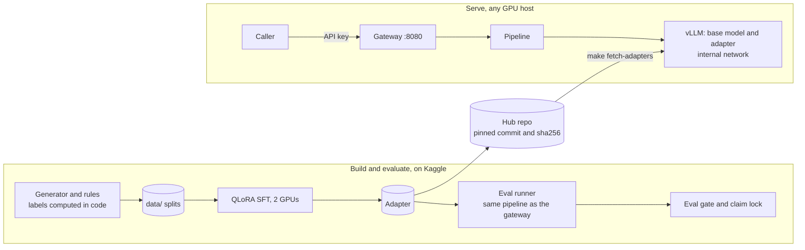
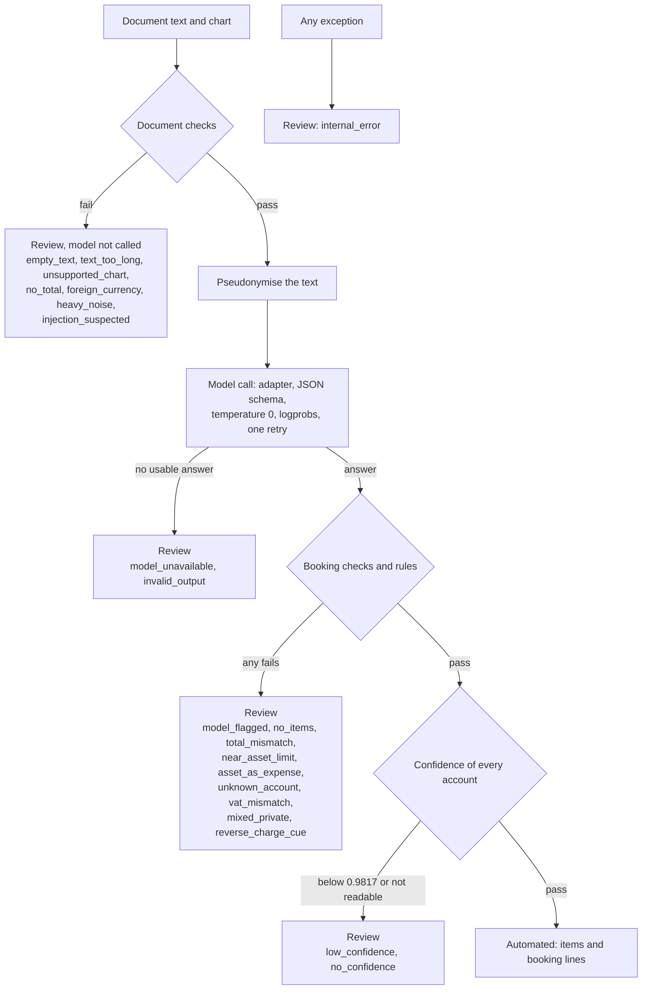

# Architecture

The system turns the text of an invoice or receipt into booking lines, or says that a person has to look at it. One Qwen3-4B base model carries a LoRA adapter for the `tax-booking` platform. A pipeline of plain code surrounds the model, and a gateway is the only part that is exposed. The decisions behind this are in `docs/adr/`.

## Components and data flow

| Part | Code | Job |
|---|---|---|
| Platform | `platforms/tax-booking/` | Chart of accounts and VAT rules, the prompt, the gate thresholds |
| Data | `src/adapt/data/` | Seeded generator, layouts and noise, edge cases, pseudonymisation, splits |
| Training | `src/adapt/train/` | QLoRA SFT with the loss on the answer only, checkpoint choice on `dev_real` |
| Pipeline | `src/adapt/pipeline.py` | The checks and the model call. The eval runner and the gateway both call it, so what I evaluate is what I serve |
| Evaluation | `src/adapt/eval/` | Metrics, intervals, the ten-check gate, the lock on the final claim |
| Serving | `configs/serve.yaml`, `src/adapt/serve.py` | One file gives the vLLM flags to the local launcher and to the container |
| Gateway | `src/adapt/gateway/` | API keys, the allowlist of platforms, audit log, health and metrics |

The model answers with one JSON object that a JSON schema constrains: supplier, date, total, and per item a description, the printed amount, an account from the list and a VAT rate of 19, 7 or 0, plus `reverse_charge`, `needs_review` and a short reason. It copies amounts and never calculates. Code computes net, VAT and the reverse-charge liability, and builds the booking lines.

## The processing pipeline

The pipeline fails closed. A document is automated only when every step passes. Any failure and any exception ends in `needs_review` with a reason.

The confidence of a document is the lowest probability among its account values, taken from the log-probabilities of the tokens that spell them. The threshold, 0.9817, was chosen on `dev` and `dev_real` together with the critical-error limit first. A review is a result like any other: the response lists the reasons, and a person decides.

## Gateway API

The gateway is the only service with a published port (8080). vLLM runs on a network that has no route out.

| Endpoint | Purpose |
|---|---|
| `POST /v1/{platform}/process` | Body: `document_text` (up to 100,000 characters) and `chart`. Returns `needs_review`, `reasons`, the document header, `items`, `booking_lines`, the adapter name and hash, and the confidence |
| `GET /healthz` | The process is alive. No key, no model call |
| `GET /readyz` | 200 when vLLM answers, serves the base model and every adapter, and the adapter files have the hash in `configs/serve.yaml`. Otherwise 503 with the problems |
| `GET /metrics` | Prometheus: requests by platform and outcome, review reasons, a latency histogram |

- **Keys.** An API key is stored as a SHA-256 hash in `configs/keys.yaml` (gitignored; `configs/keys.example.yaml` is the format) with the platforms it may use. No key or an unknown key gives 401. A key without the platform gets 403, and an unknown platform gets the same 403. A platform is served by the adapter of the same name, and a request cannot name another model.
- **Audit log.** One JSON line per request: time, request ID, platform, key ID, SHA-256 of the pseudonymised input, adapter name and hash, base revision, prompt hash, outcome, review reasons and latency. The document text is never written, and a test checks that no input substring longer than 8 characters appears. If the line cannot be written, the request fails.
- **`/metrics` and `/readyz` are public** on the same port. They hold no document text or key, but a deployment on an open network should put them behind a proxy.

## Kaggle and Azure

**Kaggle** (2× T4) is where I trained, evaluated and developed. It has no Docker, so `make serve-local` starts vLLM and the gateway as two processes from `configs/serve.yaml`. Data on Kaggle is synthetic only.

**A VM** runs `deploy/compose.yaml`: the official vLLM image at the pinned tag with one GPU, the gateway built from `deploy/gateway.Dockerfile`, weights and adapters mounted read-only. `make compose-env` writes the container's arguments from the same `configs/serve.yaml`, and a test checks that the container gets the flags of the local launcher. `make fetch-weights` and `make fetch-adapters` fill the mounted folders, and serving is offline. I planned an Azure `NC4as_T4_v3` in Germany West Central for this, with the same T4 as Kaggle.

What I have and have not run:

| Step | Status |
|---|---|
| Gateway against a fake model server (keys, 401/403, audit log, health, metrics) | tested |
| Gateway image: build, start, `/healthz` 200, `/readyz` 503 without vLLM | run on a laptop |
| `docker compose config` | validated |
| `make fetch-adapters`: download from the Hub, hash matches | run |
| The smoke test (`make serve-check`, `notebooks/kaggle_serve_check.ipynb`) against the gateway and a fake model server | run on a laptop |
| vLLM 0.30.0 with the adapter and the gateway through `make serve-local`, on one Kaggle T4 (`results/serving/smoke-test.json`) | run: 10 of 10 checks passed |
| The compose file with the vLLM image and a GPU | not run |
| The Azure VM (runbook: `deploy/README.md`) | not run |

The smoke test shows that the stack starts and answers: vLLM was ready after 291 seconds, it served `qwen3-4b` and `tax-booking`, the gateway returned 401 and 403 where it should, six dev documents got an answer, and the audit log held a record for every request with the adapter hash and the base revision. It is not a measurement of the model, and the documents are too few for a rate. Each answer took 7 to 20 seconds, one request at a time on the T4, and the first ones include kernel compilation, so this says nothing about capacity. The load benchmark is future work.
